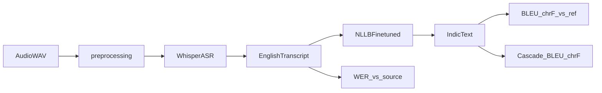

# Architecture

English→Indic cascaded ST from the IWSLT 2025 JU-CSE-NLP system paper.

## Pipeline

## Modules

| Module | Role |
|---|---|
| `preprocessing.py` | §3.1: normalize → 3 kHz LPF → +10 dB (soft-clip) |
| `asr/whisper.py` | Frozen Hugging Face Whisper (Small) |
| `translation/nllb.py` | NLLB-200-distilled-600M + optional checkpoint |
| `pipeline.py` | `CascadePipeline` |
| `train.py` | §4.1 full NLLB fine-tune via `Seq2SeqTrainer` |
| `evaluation.py` | `asr` / `mt` / `cascade` protocols |

## Languages

Configs under `configs/` cover En → Bn / Hi / Ta. Each sets the same Whisper checkpoint (`language_id: en`) plus NLLB FLORES-200 codes (`eng_Latn` → `ben_Beng` / `hin_Deva` / `tam_Taml`), shared preprocess and train defaults.

Indic→English is out of scope here (see sibling `Indic-to-English/`).

## Runtime

1. `load_config` — language + preprocess checks
2. Preprocess to 16 kHz mono (§3.1)
3. Whisper ASR (no ASR fine-tuning)
4. NLLB (+ optional fine-tuned checkpoint)
5. Optional protocol eval with split label
