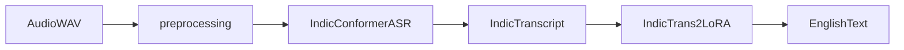

# Indic→English Cascaded Speech Translation

Package root for the Indic→English half of the IWSLT 2025 release (sibling folder: `English-to-Indic/`).

Config-driven cascade used in JU-CSE-NLP’s IWSLT 2025 Indic Track system:

**IndicConformer (ASR) → LoRA IndicTrans2 (MT)** for Bengali, Hindi, and Tamil.

English→Indic (Whisper + NLLB) is out of scope.

## Citation

Dhar, Lahiri, Mondal, and Bandyopadhyay. *JU-CSE-NLP’s Cascaded Speech to Text Translation Systems for IWSLT 2025 in Indic Track.* In *Proceedings of the 22nd International Conference on Spoken Language Translation (IWSLT 2025)*, pages 201–205. ACL.

See [`CITATION.cff`](CITATION.cff). The PDF `2025.iwslt-1.18.pdf` is included for provenance.

## Cascade



| Direction | Config |
|---|---|
| Bengali → English | `configs/bn_en.yaml` |
| Hindi → English | `configs/hi_en.yaml` |
| Tamil → English | `configs/ta_en.yaml` |

You supply IWSLT data and LoRA adapters. This repo does not claim full end-to-end revalidation in CI.

## Layout

```text
├── configs/                 # bn/hi/ta → en
├── src/indic_speech_translation/
│   ├── preprocessing.py     # paper §3.1
│   ├── asr/indicconformer.py
│   ├── translation/indictrans2.py
│   ├── pipeline.py
│   ├── inference.py
│   ├── train.py
│   └── evaluation.py
├── scripts/
├── notebooks/               # original research notebooks
├── docs/
├── tests/
└── 2025.iwslt-1.18.pdf
```

## Install

```bash
python -m venv .venv
source .venv/bin/activate
pip install -e ".[dev]"
pip install IndicTransToolkit   # training + IndicProcessor
# ASR: AI4Bharat NeMo (nemo-v2) from source — docs/reproducibility.md
```

Needs: IWSLT 2025 Indic Track data, IndicConformer checkpoints, IndicTrans2 `ai4bharat/indictrans2-indic-en-1B`, optional LoRA via `mt.adapter_path`, GPU recommended.

Do not commit datasets, checkpoints, adapters, or secrets.

## Config defaults (paper-aligned)

- Preprocess: `target_sr=16000`, `lowpass_hz=3000`, `gain_db=10.0`
- Train: `lr=2e-5`, batch `4`, LoRA `r=4` / `alpha=16`, `weight_decay=0.01`, `epochs=5`, beam `5`, fp16

Set `train.data_dir` and `mt.adapter_path` locally.

## Commands

```bash
python scripts/run_inference.py --audio path/to.wav --config configs/ta_en.yaml
python scripts/train_translation.py --config configs/ta_en.yaml
python scripts/evaluate.py --config configs/ta_en.yaml --protocol cascade --manifest path/to.csv
python scripts/evaluate.py --config configs/ta_en.yaml --protocol asr --manifest path/to.csv
python scripts/evaluate.py --config configs/ta_en.yaml --protocol mt --manifest path/to.csv
```

```python
from indic_speech_translation import CascadePipeline

pipe = CascadePipeline.from_config("configs/bn_en.yaml")
result = pipe.translate_audio("utterance.wav")
print(result.asr_text, result.translation)
```

## Paper results (quoted)

Segment counts (**Table 1**):

| Direction | Train | Dev | Test |
|---|---:|---:|---:|
| Bengali → English | 64868 | 395 | 866 |
| Hindi → English | 248872 | 397 | 579 |
| Tamil → English | 211303 | 457 | 956 |

WER / SacreBLEU with vs without preprocessing (**Table 2**, pretrained):

| System | Score | Bengali | Hindi | Tamil |
|---|---|---:|---:|---:|
| Indic→En (w/o prep) | WER | 56.57 | 37.42 | 65.81 |
| Indic→En (w/o prep) | SacreBLEU | 26.05 | 31.19 | 27.78 |
| Indic→En (with prep) | WER | 48.32 | 36.93 | 56.17 |
| Indic→En (with prep) | SacreBLEU | 39.17 | 46.28 | 37.69 |

SacreBLEU on IndicConformer outputs + pretrained NMT (**Table 5**, Dev):

| NMT Model | Bn–En | Hi–En | Ta–En |
|---|---:|---:|---:|
| mBART | 8.92 | 22.02 | 13.77 |
| NLLB 200 | 21.09 | 0.50 | 9.29 |
| IndicTrans2 | 42.80 | 31.19 | 27.78 |

Finetuned cascade SacreBLEU on Dev (**Table 6**, Indic→English):

| System | Bengali | Hindi | Tamil |
|---|---:|---:|---:|
| Indic to English | 39.17 | 46.28 | 37.69 |

Test BLEU / chrF++ (**Table 7**, Indic→English):

| Score | Bengali | Hindi | Tamil |
|---|---:|---:|---:|
| BLEU | 23.69 | 44.13 | 17.66 |
| chrF++ | 53.99 | 67.91 | 49.34 |

Dev IndicConformer WER (§5): Bn 48.32%, Hi 36.93%, Ta 56.17%.

Numbers above are from the paper only; this package does not invent new runs.

## Hardware

See [`docs/reproducibility.md`](docs/reproducibility.md) and [`docs/architecture.md`](docs/architecture.md). Paper fine-tuning used Kaggle T4×2.

## License

`LICENSE` is TBD. Third-party models (IndicConformer, IndicTrans2, NeMo, Transformers, etc.) keep their own licenses.

## BibTeX

```bibtex
@inproceedings{dhar-etal-2025-ju,
  title = {{JU-CSE-NLP}'s Cascaded Speech to Text Translation Systems for {IWSLT} 2025 in Indic Track},
  author = {Dhar, Debjit and Lahiri, Soham and Mondal, Tapabrata and Bandyopadhyay, Sivaji},
  booktitle = {Proceedings of the 22nd International Conference on Spoken Language Translation (IWSLT 2025)},
  pages = {201--205},
  year = {2025},
  publisher = {Association for Computational Linguistics}
}
```
