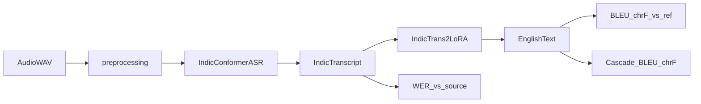

# Architecture

Indic→English cascaded ST from the IWSLT 2025 JU-CSE-NLP system paper.

## Pipeline

## Modules

| Module | Role |
|---|---|
| `preprocessing.py` | §3.1: normalize → 3 kHz LPF → +10 dB (soft-clip) |
| `asr/indicconformer.py` | Frozen NeMo IndicConformer hybrid RNNT |
| `translation/indictrans2.py` | IndicTrans2 + optional LoRA |
| `pipeline.py` | `CascadePipeline` |
| `train.py` | §4.2 LoRA via `Seq2SeqTrainer` |
| `evaluation.py` | `asr` / `mt` / `cascade` protocols |

## Languages

Configs under `configs/` cover Bn / Hi / Ta → En. Each sets ASR checkpoint + `language_id`, IndicTrans2 codes (`ben_Beng` / `hin_Deva` / `tam_Taml` → `eng_Latn`), shared preprocess and train defaults.

English→Indic is out of scope.

## Runtime

1. `load_config` — language + preprocess checks
2. Preprocess to 16 kHz mono (§3.1)
3. IndicConformer ASR (no ASR fine-tuning)
4. IndicTrans2 (+ optional adapter)
5. Optional protocol eval with split label
